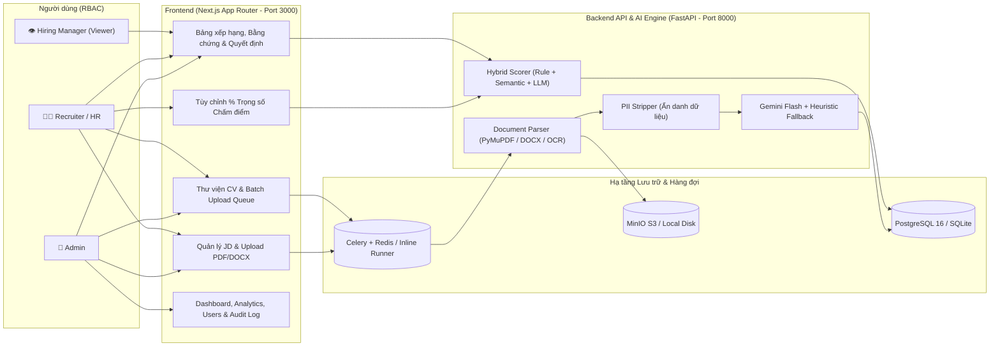

# TalentLens — AI Resume Screening System

Nền tảng sàng lọc hồ sơ ứng viên (CV) và xếp hạng ứng viên bằng Trí tuệ Nhân tạo có khả năng giải thích (**Explainable AI**), hỗ trợ đội ngũ Nhân sự (HR), Chuyên viên Tuyển dụng (Recruiter) và Quản lý Tuyển dụng (Hiring Manager) tự động hóa quy trình bóc tách CV/JD, ẩn danh thông tin cá nhân (PII), chấm điểm đa tầng có trích dẫn bằng chứng nguyên văn và gợi ý câu hỏi phỏng vấn một cách minh bạch, công bằng và hiệu quả.

## 👥 Thành viên & Phân công nhiệm vụ
*(Phân chia theo kiến trúc 4 lát cắt dọc độc lập — chi tiết tại [`docs/team-distribution.md`](docs/team-distribution.md))*

| STT | Thành viên / Phân hệ | Nhiệm vụ đảm nhận |
|-----|----------------------|-------------------|
| 1 | **Person A — Foundation, Auth & Audit** | Quản lý Tài khoản & Phân quyền RBAC (`Admin`, `Recruiter`, `Viewer`), xác thực JWT + `bcrypt`, cấu hình Database (`SQLAlchemy 2.0 Async` + `Alembic`), Nhật ký kiểm toán bất biến (`Audit Log`), Dashboard thống kê & Phân tích (`Analytics`). |
| 2 | **Person B — CV Pipeline, Parsing & Storage** | Luồng tải lên CV đơn lẻ/hàng loạt (`PDF`, `DOCX`), chống trùng lặp bằng `SHA-256`, lưu trữ đối tượng (`MinIO S3` / Local Disk + bản sao DB), điều phối hàng đợi bất đồng bộ (`Celery` + `Redis` / `Inline Runner`), bộ bóc tách văn bản (`PyMuPDF`, `pypdf`, `python-docx`) kết hợp nhận diện quang học `Tesseract OCR` cho PDF dạng ảnh scan. |
| 3 | **Person C — AI Extraction, PII & Hybrid Scoring** | Bộ lọc ẩn danh thông tin nhạy cảm (`PII Stripper` bằng Regex trước khi gửi AI), trích xuất cấu trúc CV/JD bằng `Google Gemini API` kèm cơ chế dự phòng `Offline Heuristic Parser`, thuật toán chấm điểm lai 3 tầng (`Rule-based` + `Semantic` + `LLM`), trích xuất bằng chứng nguyên văn (`Evidence Snippets`) và sinh câu hỏi phỏng vấn. |
| 4 | **Person D — JD Management, Ranking UI & Frontend** | Kiến trúc Frontend `Next.js` (App Router, Feature-Driven, Song ngữ Anh/Việt), Quản lý vị trí tuyển dụng (JD) kèm tính năng **Upload file PDF/DOCX tự động điền form JD**, bộ **Tùy chỉnh tỷ lệ % trọng số chấm điểm linh hoạt** theo từng JD/CV, Bảng xếp hạng ứng viên (`Ranking Review`) và quy trình phê duyệt **Human-in-the-Loop**. |

---

## 🚀 Tính năng chính

- **👤 Quản lý Tài khoản & Phân quyền (RBAC):** Đăng ký (có kiểm soát mở/đóng đăng ký công khai), đăng nhập, đổi mật khẩu và quản lý trạng thái tài khoản. Phân quyền chặt chẽ cho 3 vai trò: `Admin` (toàn quyền quản trị người dùng, hệ thống & xem Audit Log), `Recruiter` (quản lý JD, tải CV, tùy chỉnh trọng số, chạy AI Matching & duyệt ứng viên), và `Viewer` (chế độ chỉ đọc cho Hiring Manager).
- **📋 Quản lý Tin tuyển dụng (JD) & Bóc tách File JD tự động:** Tạo, chỉnh sửa, lọc và lưu trữ các vị trí tuyển dụng. Tích hợp tính năng **Upload file JD (`PDF` / `DOCX`)** tại endpoint `POST /api/v1/jobs/extract-file` giúp hệ thống tự động đọc hiểu (qua Gemini AI hoặc Heuristic) và điền sẵn các trường *Tiêu đề, Phòng ban, Địa điểm, Mô tả, Yêu cầu, Kỹ năng, Số năm kinh nghiệm, Học vấn* để HR kiểm tra trước khi lưu.
- **📄 Pipeline Xử lý CV Đơn lẻ / Hàng loạt & OCR:** Hỗ trợ tải lên từng CV hoặc hàng đợi tải lên nhiều CV cùng lúc (`PDF`, `DOCX`), tự động phát hiện và đồng bộ lại nếu file trùng mã băm `SHA-256`, kết hợp `Tesseract OCR` khi phát hiện file PDF là bản scan/ảnh chụp.
- **🛡️ Ẩn danh Thông tin Cá nhân (Privacy-First PII Masking) & Blind Review:** Tự động phát hiện và che dấu Email, Số điện thoại, Ngày sinh, Đường dẫn mạng xã hội và Địa chỉ cá nhân (`[EMAIL]`, `[PHONE]`, `[LINK]`, `[DOB]`, `[ADDRESS]`) trước khi đưa văn bản vào mô hình AI. Trên giao diện, HR có thể bật/tắt chế độ **Ẩn danh tính ứng viên (Blind Review)** để giảm thiểu thiên kiến vô thức (*Unconscious Bias*).
- **⚖️ Chấm điểm Lai 3 Tầng (Hybrid Scoring) & Tùy chỉnh Trọng số (%):** Kết hợp 3 phương pháp: **Chấm theo quy tắc cứng (`Rule-based`)**, **Đo độ tương đồng ngữ nghĩa (`Semantic`)** và **Đánh giá chuyên sâu bằng AI (`LLM Evaluation`)**. HR có thể **tùy chỉnh linh hoạt tỷ lệ % chấm điểm** của từng hạng mục (*Kỹ năng, Kinh nghiệm, Học vấn* và *Rule, Semantic, AI*) mặc định cho từng vị trí JD hoặc chấm lại trực tiếp trên từng hồ sơ ứng viên.
- **🔍 Giải thích Minh bạch kèm Bằng chứng & Câu hỏi Phỏng vấn (Explainable AI):** Mỗi điểm số đều đi kèm **trích dẫn nguyên văn từ CV (`Evidence Snippets`)** theo 3 mức (`found`, `partial`, `not_found`), danh sách kỹ năng khớp (`Matched Skills`), kỹ năng còn thiếu (`Missing Skills`), điểm mạnh, khoảng trống năng lực và bộ **Câu hỏi phỏng vấn cá nhân hóa**.
- **🤝 Quyết định Tuyển dụng có Con người Kiểm soát (Human-in-the-Loop & Audit Log):** AI chỉ đóng vai trò cố vấn chấm điểm; quyết định cuối cùng (`pending` — Chờ duyệt, `shortlisted` — Rút gọn, `interview` — Phỏng vấn, `hired` — Tuyển dụng, `rejected` — Từ chối) kèm ghi chú đánh giá thuộc về HR và được ghi vết toàn bộ vào **Nhật ký kiểm toán (`Audit Log`)** và **Lịch sử sàng lọc (`Screening History`)**.

---

## 🗺 Sơ đồ Use Case & Luồng Kiến trúc



---

## 🛠 Công nghệ sử dụng

**Frontend (`frontend/`)**
- **Framework & Ngôn ngữ:** `Next.js 16` (App Router), `React 19`, `TypeScript 5`
- **Styling & Đa ngôn ngữ:** `Tailwind CSS v4` kết hợp hệ thống Design Tokens (`tokens.css`, `workspace.css`), chuyển đổi ngôn ngữ tức thời (**Tiếng Việt / Tiếng Anh**)
- **Kiến trúc:** Feature-Based & Layered Architecture (`app/` Route Groups, `components/ui/`, `components/layout/`, `features/`, `hooks/`, `providers/`, `lib/`)
- **Kiểm thử & Chất lượng:** `Vitest`, `React Testing Library`, `ESLint 9`, `Prettier`

**Backend & AI Engine (`backend/`)**
- **Framework:** `Python 3.11+`, `FastAPI`, `Pydantic v2`, `pydantic-settings`, `Uvicorn`
- **Database & ORM:** `PostgreSQL 16` (`asyncpg` / `psycopg`) hoặc `SQLite` (`aiosqlite`), `SQLAlchemy 2.0 Async` và quản lý migration bằng `Alembic`
- **Hàng đợi & Lưu trữ:** `Celery` + `Redis 7` (tự động chuyển sang `Inline Asyncio Runner` khi chạy local không cần Redis), `MinIO` (`boto3` S3-compatible) hoặc `Local Disk`
- **Xử lý Tài liệu & OCR:** `PyMuPDF`, `pypdf`, `python-docx`, `Pillow`, `pytesseract` (`Tesseract OCR`)
- **AI / NLP:** `google-genai` (`gemini-flash-latest` & `gemini-embedding-001`) kết hợp **Offline Deterministic Heuristic Engine** & **Hashing Embeddings** (đảm bảo hệ thống hoạt động 100% ngay cả khi không có API Key)
- **Bảo mật:** `JWT` (`python-jose`) và mã hóa mật khẩu bằng `bcrypt`
- **Kiểm thử & Linter:** `Pytest`, `pytest-asyncio`, `httpx`, `Ruff`

---

## 🔗 Danh sách đường dẫn truy cập (Local)

| Kênh truy cập | Đường dẫn (URL) | Mô tả |
|---------------|-----------------|-------|
| 🏠 **Website chính (Frontend)** | [http://localhost:3000](http://localhost:3000) | Giao diện làm việc cho Admin, Recruiter và Viewer (kèm trang `/demo`). |
| 📘 **Swagger API Docs** | [http://localhost:8000/docs](http://localhost:8000/docs) | Tài liệu REST API trực quan (`/api/v1/*`), hỗ trợ test trực tiếp các endpoint. |
| 📕 **ReDoc API Reference** | [http://localhost:8000/redoc](http://localhost:8000/redoc) | Tài liệu đặc tả kỹ thuật chi tiết các Schema và Endpoint. |
| 🗄️ **MinIO Console** | [http://localhost:9001](http://localhost:9001) | Giao diện quản lý kho lưu trữ file CV (khi chạy với Docker Compose). |

---

## 🔐 Tài khoản trải nghiệm mặc định (Auto-Seed)

Hệ thống tự động khởi tạo sẵn 2 tài khoản cố định ngay khi khởi chạy Backend (`SEED_DEFAULT_USERS=true`). Bạn có thể đăng nhập ngay tại `/login`:

| Vai trò | Email đăng nhập | Mật khẩu | Quyền hạn |
|:--------|:----------------|:---------|:----------|
| **Admin** *(Tự động tạo sẵn)* | `admin@talentlens.ai` | `Admin@123` | Toàn quyền hệ thống, xem Audit Log, quản lý tài khoản & phân quyền tại `/users`. |
| **Recruiter** *(Tự động tạo sẵn)* | `recruiter@talentlens.ai` | `Recruiter@123` | Tạo/upload JD, tải CV, chỉnh % trọng số, chạy AI Matching và ra quyết định tuyển dụng. |
| **Viewer** *(Tạo thêm tại `/users`)* | *(Do Admin cấp)* | *(Do Admin cấp)* | Chế độ chỉ đọc bảng xếp hạng, bằng chứng CV, lịch sử và báo cáo phân tích. |

---

## ⚙️ Hướng dẫn Cài đặt & Chạy Local

### 1. Yêu cầu (Prerequisites)
- **Python:** `3.11+`
- **Node.js:** `20+` (kèm `pnpm` hoặc `npm`)
- **Tùy chọn:** `Docker Desktop` (nếu chạy toàn bộ bằng container với `PostgreSQL`, `Redis`, `MinIO`) và `Tesseract OCR` (nếu cần OCR cho CV ảnh scan).

### 2. Cài đặt Dependencies
```powershell
# 1. Cài đặt Backend
cd backend
python -m venv .venv
.\.venv\Scripts\Activate.ps1
pip install -e ".[dev]"
cd ..

# 2. Cài đặt Frontend
cd frontend
pnpm install   # hoặc: npm install
cd ..
```

### 3. Cấu hình Biến môi trường (`.env`)
Khi chạy bằng script `.\start-dev.ps1`, hệ thống sẽ **tự động sinh** `backend/.env` và `frontend/.env.local` với cấu hình chạy ngay không cần Docker. Nếu cấu hình thủ công từ tệp mẫu [`.env.example`](.env.example):

```powershell
cp .env.example .env
```

Các biến cấu hình chính trong [`backend/app/core/config.py`](backend/app/core/config.py):
- `DATABASE_URL`: Để trống để dùng PostgreSQL từ các biến `POSTGRES_*`, hoặc đặt `sqlite+aiosqlite:///./dev.db` khi chạy local nhanh với SQLite.
- `STORAGE_BACKEND`: `minio` (khi dùng Docker) hoặc `local` (lưu file trực tiếp tại `backend/storage/`).
- `PIPELINE_MODE`: `celery` (chạy qua Redis + Celery Worker) hoặc `inline` (chạy bất đồng bộ ngay trong tiến trình API).
- `SECRET_KEY`: Chuỗi khóa bí mật dùng để ký JWT Access Token.
- `LLM_PROVIDER` & `GEMINI_API_KEY`: Mặc định `LLM_PROVIDER=gemini` (sử dụng mô hình `gemini-flash-latest` và `gemini-embedding-001`). Nếu không điền `GEMINI_API_KEY`, hệ thống tự động chuyển sang chế độ **Offline Heuristic** (`LLM_FALLBACK_TO_HEURISTIC=true`).
- `NEXT_PUBLIC_API_BASE_URL`: Đường dẫn Backend API cho Frontend (mặc định `http://localhost:8000`).

### 4. Khởi chạy Hệ thống

**Cách 1 — Chạy nhanh trên Windows bằng Script tự động (Khuyên dùng khi phát triển):**
```powershell
.\start-dev.ps1
```
*(Tự động tạo cấu hình SQLite + Local Storage + Inline Pipeline và mở 2 cửa sổ chạy Backend tại cổng `8000`, Frontend tại cổng `3000`).*

**Cách 2 — Chạy thủ công trên 2 cửa sổ Terminal:**
- **Terminal 1 (Backend API — Cổng 8000):**
  ```powershell
  cd backend
  .\.venv\Scripts\Activate.ps1
  uvicorn app.main:app --reload --port 8000
  ```
- **Terminal 2 (Frontend Next.js — Cổng 3000):**
  ```powershell
  cd frontend
  pnpm dev   # hoặc: npm run dev
  ```

**Cách 3 — Chạy đầy đủ bằng Docker Compose (`PostgreSQL 16`, `Redis 7`, `MinIO`, `Backend`, `Worker`, `Frontend`):**
```powershell
docker compose up --build
```

---

## 🧪 Kiểm thử & Đảm bảo Chất lượng (Quality Gates)

```powershell
# Kiểm tra Linter & chạy Unit/Integration Tests cho Backend
cd backend
ruff check app tests
pytest -q

# Kiểm tra Typecheck, ESLint, Prettier & chạy Vitest cho Frontend
cd ../frontend
pnpm run typecheck
pnpm run lint
pnpm run format:check
pnpm run test
```

---

## 🗂 Cấu trúc Dự án (Enterprise Monorepo Structure)

Hệ thống được tổ chức theo chuẩn **Enterprise Monorepo Architecture**, đảm bảo **Separation of Concerns (SoC)**, **Single Responsibility Principle (SRP)** và kiến trúc **Feature-Driven / Layered Architecture**:

```text
AIResumeScreeningSystem/
├── .github/
│   └── workflows/                      # CI/CD Pipelines (backend.yml & frontend.yml)
├── backend/                            # ── PHÂN HỆ BACKEND API & AI ENGINE (FastAPI) ──
│   ├── alembic/                        # Quản lý phiên bản Database Migration (0001 -> 0005)
│   ├── app/
│   │   ├── api/                        # Tầng Giao tiếp REST API (Controllers, Dependencies & Router Registry)
│   │   │   ├── router.py               # Điểm đăng ký tập trung toàn bộ API v1 Endpoints (/api/v1)
│   │   │   ├── deps.py                 # Dependencies dùng chung (AsyncSession, JWT User, RBAC Guard)
│   │   │   ├── auth.py                 # Đăng ký, đăng nhập, lấy thông tin phiên (/me), đổi mật khẩu
│   │   │   ├── users.py                # Quản trị người dùng & phân quyền RBAC (Admin)
│   │   │   ├── jobs.py                 # CRUD vị trí tuyển dụng (JD) & Upload PDF/DOCX bóc tách JD
│   │   │   ├── cvs.py                  # Upload CV đơn/hàng loạt, tải file gốc & xử lý lại CV
│   │   │   ├── matching.py             # Chấm điểm CV-JD, cập nhật % trọng số, lưu quyết định & lịch sử
│   │   │   ├── dashboard.py            # Thống kê tổng quan KPI (`/summary`) & biểu đồ (`/analytics`)
│   │   │   ├── audit.py                # Truy xuất nhật ký kiểm toán bất biến (Audit Trail)
│   │   │   └── system.py               # Thông tin trạng thái AI Engine & cấu hình hệ thống (`/system/info`)
│   │   ├── core/                       # Tầng Hạ tầng Cốt lõi (Core Infrastructure)
│   │   │   ├── config.py               # Cấu hình tập trung (Pydantic Settings)
│   │   │   ├── database.py             # SQLAlchemy 2.0 Async Engine & Session Factory
│   │   │   ├── security.py             # Xác thực JWT & mã hóa mật khẩu Bcrypt
│   │   │   └── exceptions.py           # Hệ thống ngoại lệ nghiệp vụ chuẩn hóa (AppError)
│   │   ├── llm/                        # Tầng Kết nối Mô hình Ngôn ngữ Lớn (LLM Abstraction Layer)
│   │   │   ├── base.py                 # Giao diện trừu tượng BaseLLM
│   │   │   ├── gemini.py               # Tích hợp Google Gemini SDK & Vector Embeddings
│   │   │   └── factory.py              # Khởi tạo LLM kèm cơ chế tự động chuyển đổi Offline Heuristic
│   │   ├── models/                     # Tầng Dữ liệu SQLAlchemy ORM Entities (User, Job, CV, CVFile, MatchResult, Decision, AuditLog)
│   │   ├── schemas/                    # Tầng Kiểm tra Hợp đồng Dữ liệu (Pydantic v2 DTO Schemas)
│   │   ├── services/                   # Tầng Nghiệp vụ Cốt lõi & Lõi AI 3 Giai đoạn
│   │   │   ├── parsing/                # [Stage 1] Bóc tách PDF, DOCX & nhận diện ảnh Tesseract OCR
│   │   │   ├── extraction/             # [Stage 2] Ẩn danh PII (pii_stripper) & Bóc tách cấu trúc CV/JD (extractor, jd_extractor, heuristic)
│   │   │   ├── matching/               # [Stage 3] Chấm điểm lai 3 tầng (rule_scorer, semantic_scorer, llm_scorer, aggregator, embeddings, skills)
│   │   │   ├── auth_service.py         # Nghiệp vụ xác thực & khởi tạo tài khoản mặc định (Auto-Seed)
│   │   │   ├── user_service.py         # Nghiệp vụ quản lý tài khoản & phân quyền
│   │   │   ├── job_service.py          # Nghiệp vụ quản lý JD & cấu hình trọng số chấm điểm
│   │   │   ├── cv_service.py           # Nghiệp vụ lưu trữ, chống trùng lặp SHA-256 & điều phối CV
│   │   │   ├── matching_service.py     # Điều phối luồng chấm điểm, tính lại điểm theo % & quyết định HR
│   │   │   ├── audit_service.py        # Ghi vết toàn bộ thao tác quan trọng vào Audit Log
│   │   │   └── storage_service.py      # Lưu trữ đối tượng đa môi trường (MinIO S3 / Local Disk)
│   │   ├── workers/                    # Tầng Xử lý Hàng đợi Bất đồng bộ (Celery + In-Process Asyncio Runner)
│   │   │   ├── celery_app.py           # Cấu hình Celery Broker
│   │   │   ├── dispatch.py             # Bộ điều phối thông minh (Tự động fallback sang Inline Runner)
│   │   │   ├── parse_task.py           # Task bóc tách văn bản CV
│   │   │   ├── extract_task.py         # Task ẩn danh PII & trích xuất thông tin ứng viên
│   │   │   └── score_task.py           # Task chấm điểm & xếp hạng tự động
│   │   └── main.py                     # Điểm khởi chạy ứng dụng FastAPI
│   └── tests/                          # Bộ Unit Test & Integration Test (Pytest — Phản chiếu cấu trúc app/)
├── frontend/                           # ── PHÂN HỆ GIAO DIỆN NGƯỜI DÙNG (Next.js App Router + React 19) ──
│   ├── src/
│   │   ├── app/                        # Tầng Định tuyến Next.js App Router (Chia theo 3 Route Groups chuẩn)
│   │   │   ├── (marketing)/            # Nhóm trang Public: Landing Page (/) & Trải nghiệm Demo (/demo)
│   │   │   ├── (auth)/                 # Nhóm trang Xác thực: Đăng nhập (/login) & Đăng ký (/register)
│   │   │   ├── (workspace)/            # Nhóm trang Nghiệp vụ HR/Admin (/dashboard, /jobs, /cvs, /rankings, /history, /analytics, /audit, /users, /settings)
│   │   │   └── layout.tsx              # Root Layout & Providers
│   │   ├── components/                 # Tầng Giao diện Tái sử dụng (Shared Presentation Layer)
│   │   │   ├── ui/                     # Atomic UI Primitives (BrandLogo, Charts, Dialog, Icon, MetricCard, MotionPreference, Skeleton)
│   │   │   └── layout/                 # Khung bố cục ứng dụng (AppShell, AuthLayout, LanguageSwitcher)
│   │   ├── features/                   # Tầng Module Nghiệp vụ Độc lập (Feature-Driven Domain Modules)
│   │   │   ├── auth/                   # Form đăng nhập, đăng ký & kiểm soát mở đăng ký (auth-form, registration-gate)
│   │   │   ├── dashboard/              # Bảng điều khiển tổng quan & KPI tuyển dụng (dashboard-overview)
│   │   │   ├── jobs/                   # Quản lý JD, Upload PDF/DOCX tự động điền form & trọng số mặc định (jobs-manager)
│   │   │   ├── cvs/                    # Thư viện CV, hàng đợi tải CV hàng loạt & xem dữ liệu sau ẩn danh PII (cv-upload, cv-detail, cv-upload-queue, pipeline-steps)
│   │   │   ├── rankings/               # Bảng xếp hạng ứng viên, bằng chứng nguyên văn & bộ chỉnh % trọng số (ranking-review, scoring-weights-editor, ranking-evidence-demo)
│   │   │   ├── history/                # Tra cứu lịch sử sàng lọc & quyết định tuyển dụng (screening-history)
│   │   │   ├── analytics/              # Biểu đồ phân tích phễu tuyển dụng & phân bố điểm số (analytics-dashboard)
│   │   │   ├── audit/                  # Giao diện tra cứu nhật ký kiểm toán hệ thống (audit-log)
│   │   │   ├── users/                  # Quản lý người dùng, khóa/mở tài khoản & gán quyền RBAC (admin-user-manager)
│   │   │   ├── settings/               # Cài đặt tài khoản, chế độ ẩn danh ứng viên & trạng thái AI Engine (settings-panel)
│   │   │   └── marketing/              # Giao diện trang chủ & không gian trải nghiệm Demo (landing-page, landing-process, demo-workspace)
│   │   ├── hooks/                      # Custom React Hooks dùng chung (use-cv-upload-queue, use-flip)
│   │   ├── providers/                  # React Context Providers quản lý trạng thái toàn cục (auth-session)
│   │   ├── i18n/                       # Hệ thống đa ngôn ngữ Anh - Việt tức thời (messages.ts, provider.tsx)
│   │   ├── lib/                        # Tầng HTTP API Clients & Tiện ích nghiệp vụ (api, auth-api, jobs-api, cvs-api, matching-api, audit-api, users-api, dashboard-api, insights-api)
│   │   ├── styles/                     # Hệ thống Design Tokens & Workspace CSS (tokens.css, workspace.css)
│   │   └── __tests__/                  # Bộ Unit & Integration Tests cho Giao diện & API Client (Vitest + RTL)
│   └── package.json
├── samples/                            # ── BỘ DỮ LIỆU MẪU KIỂM THỬ (JD & CV ĐA NGÀNH) ──
│   ├── jds/                            # Các file PDF JD mẫu tiếng Anh & tiếng Việt để test Auto-fill JD
│   ├── cvs/                            # Các file CV mẫu (PDF/DOCX) phân theo nhóm năng lực để test Batch Upload & Scoring
│   └── README.md                       # Hướng dẫn sử dụng bộ dữ liệu mẫu
├── scripts/                            # ── KỊCH BẢN TIỆN ÍCH & SEED DỮ LIỆU ──
│   └── seed/                           # Script sinh tự động các bộ file CV kiểm thử
├── docs/                               # ── TÀI LIỆU KIẾN TRÚC, PHÂN CÔNG & TÍCH HỢP HỆ THỐNG ──
│   ├── ai-pipeline.md                  # Đặc tả kiến trúc Pipeline AI 3 tầng
│   ├── integration.md                  # Tài liệu tích hợp REST API & quy ước dữ liệu
│   ├── jobs-api.md                     # Đặc tả API Quản lý JD
│   ├── phase1-architecture.md          # Thiết kế kiến trúc tổng thể hệ thống
│   └── team-distribution.md            # Phân công nhiệm vụ theo 4 lát cắt dọc
├── docker-compose.yml                  # Cấu hình triển khai Container (PostgreSQL 16, Redis 7, MinIO, Backend, Worker, Frontend)
├── start-dev.ps1                       # Script khởi chạy nhanh môi trường phát triển trên Windows PowerShell
└── README.md                           # Tài liệu tổng quan dự án
```
