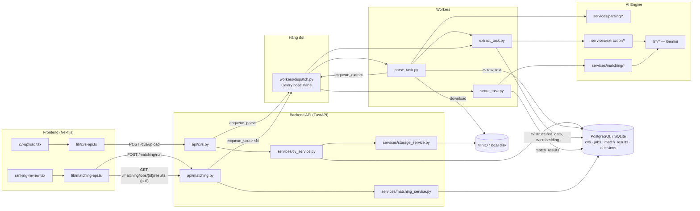

# AI Pipeline / AI Engine — Luồng dữ liệu từ file này sang file khác

Tài liệu mô tả **toàn bộ luồng AI** của TalentLens: từ lúc recruiter upload CV ở frontend, đến khi
CV được parse → trích xuất thông tin (AI) → chấm điểm với JD (AI) → xếp hạng → recruiter ra quyết định.
Mỗi bước ghi rõ **dữ liệu gì** đi **từ file nào sang file nào** và được lưu vào **cột DB nào**.

> Đường dẫn trong tài liệu tính từ thư mục gốc repo. Số dòng (`:L`) đúng tại commit `2819825`.
>
> Sơ đồ draw.io chi tiết (2 trang: Giai đoạn A và B): [ai-pipeline.drawio](ai-pipeline.drawio) — mở bằng app.diagrams.net hoặc extension Draw.io Integration trong VS Code.

---

## 0. Bức tranh tổng thể



Pipeline gồm **2 giai đoạn độc lập**:

| Giai đoạn | Kích hoạt bởi | Chuỗi task | Đầu ra cuối |
|---|---|---|---|
| **A. Xử lý CV** (ingestion) | Upload CV | `parse_cv_task` → `extract_info_task` | `cvs.raw_text`, `cvs.structured_data`, `cvs.embedding`, status `extracted` |
| **B. Matching** (scoring) | Nút **Run AI matching** | `score_match_task` (1 task / CV) | 1 dòng `match_results` cho mỗi cặp CV × JD + `rank` |

Vòng đời trạng thái CV ([backend/app/models/cv.py:16](../backend/app/models/cv.py#L16)):

```
uploaded → parsing → parsed → extracting → extracted → scoring → scored
                ↘ error         ↘ error               ↘ (lỗi chấm điểm → quay về extracted)
```

---

## 1. Giai đoạn A — Upload → Parse → Extract

### Bước A1. Frontend gửi file

| | |
|---|---|
| **File** | [frontend/src/components/cv-upload.tsx](../frontend/src/components/cv-upload.tsx) → [frontend/src/lib/cvs-api.ts:163](../frontend/src/lib/cvs-api.ts#L163) (`uploadCv`) |
| **Dữ liệu** | `FormData { candidate_name, candidate_email?, file }` |
| **Gửi tới** | `POST /api/v1/cvs/upload` |
| **Sau đó** | `cv-upload.tsx:125` tự **poll** danh sách CV khi còn CV ở trạng thái đang xử lý (`PROCESSING_STATUSES`) để cập nhật tiến trình. |

### Bước A2. API nhận file, lưu trữ, tạo bản ghi CV

| | |
|---|---|
| **File** | [backend/app/api/cvs.py:77](../backend/app/api/cvs.py#L77) (`upload_cv`) → [backend/app/services/cv_service.py:102](../backend/app/services/cv_service.py#L102) (`create_cv`) |
| **Xử lý** | Kiểm tra MIME (PDF/DOCX) · giới hạn 10 MB · tính **SHA-256** để chống trùng (`find_cv_by_hash`) · tạo object key `resumes/<hash16>_<tên>.<ext>` |
| **Ghi file** | `storage_service.upload_file(...)` → [backend/app/services/storage_service.py](../backend/app/services/storage_service.py) (MinIO, hoặc `LocalStorageService` khi `STORAGE_BACKEND=local`) |
| **Ghi DB** | Bảng `cvs`: `file_url` (= object key), `file_type`, `file_size`, `status = uploaded` |
| **Chuyển tiếp** | `api/cvs.py:105` → `_enqueue_parse_task(cv.id)` → `workers/dispatch.enqueue_parse(cv_id)` |
| **Audit** | `audit_service.record(CV_UPLOAD)` |

> Chỉ **`cv_id` (int)** được đẩy vào hàng đợi — task tự đọc lại mọi thứ từ DB.

### Bước A3. Dispatcher — chọn Celery hay Inline

| | |
|---|---|
| **File** | [backend/app/workers/dispatch.py](../backend/app/workers/dispatch.py) |
| `PIPELINE_MODE=celery` | `celery_app.send_task(...)` qua Redis vào queue `parse` / `extract` / `score` ([celery_app.py](../backend/app/workers/celery_app.py)) |
| `PIPELINE_MODE=inline` | `InlineRunner` — 1 asyncio queue chạy tuần tự trong process API (khởi động ở [main.py:38](../backend/app/main.py#L38)); `_resolve()` map tên task → hàm async |

| Hàm enqueue | Tên task | Hàm thực thi thật |
|---|---|---|
| `enqueue_parse(cv_id)` | `parse_task.parse_cv_task` | `parse_task._process_cv_parsing` |
| `enqueue_extract(cv_id)` | `extract_task.extract_info_task` | `extract_task.process_extraction` |
| `enqueue_score(job_id, cv_id)` | `score_task.score_match_task` | `score_task.process_scoring` |

### Bước A4. Parse — file nhị phân → văn bản thuần (`raw_text`)

| | |
|---|---|
| **File** | [backend/app/workers/parse_task.py:41](../backend/app/workers/parse_task.py#L41) (`_process_cv_parsing`) |
| **Đọc** | `cvs` theo `cv_id` → status `parsing` → `storage_service.download_file(cv.file_url)` → **bytes** |
| **Gọi** | `parse_document(content=bytes, file_type=cv.file_type, enable_ocr=True)` — [services/parsing/\_\_init\_\_.py:64](../backend/app/services/parsing/__init__.py#L64) |
| **Ghi DB** | `cvs.raw_text = text`, `status = parsed` (lỗi → `error` + `error_message`) |
| **Chuyển tiếp** | `_trigger_downstream_extract(cv_id)` → `dispatch.enqueue_extract(cv_id)` |
| **Retry (Celery)** | 3 lần, cách 30 s với lỗi tạm thời (`StorageServiceError`, `ConnectionError`) |

Bên trong module parsing:

```
parse_document()                       services/parsing/__init__.py
 └─ get_parser(file_type)  ──►  PDFParser | DOCXParser | OCRParser
     PDFParser.parse()                 services/parsing/pdf_parser.py
       pypdf ─(<50 ký tự)→ PyMuPDF ─(<50)→ pdfplumber ─(<50)→ OCRParser (Tesseract eng+vie)
     DOCXParser.parse()                services/parsing/docx_parser.py
       python-docx (header, đoạn, bảng, footer) → zip+XML fallback → legacy .doc
     OCRParser.parse()                 services/parsing/ocr_parser.py
       PDF → ảnh (PyMuPDF 200dpi / pdf2image / ảnh nhúng) → pytesseract
 └─ clean_text()                       services/parsing/base.py:15
       NFKC, bỏ ký tự điều khiển, CRLF→LF, gộp khoảng trắng, tối đa 1 dòng trống
```

**Hợp đồng dữ liệu `raw_text`** (B → C): UTF-8 thuần, LF, 1 khoảng trắng, các trang nối liền, không markup.

### Bước A5. Extract — `raw_text` → hồ sơ có cấu trúc + embedding

| | |
|---|---|
| **File** | [backend/app/workers/extract_task.py:28](../backend/app/workers/extract_task.py#L28) (`process_extraction`) |
| **Đọc** | `cvs.raw_text`, `cvs.candidate_name` → status `extracting` |
| **Bước 1** | `llm = get_llm_or_none()` — [llm/factory.py:35](../backend/app/llm/factory.py#L35) (trả `None` nếu `LLM_PROVIDER=heuristic` hoặc thiếu `GEMINI_API_KEY`) |
| **Bước 2** | `extract_cv(raw_text, candidate_name, llm)` — [services/extraction/extractor.py:50](../backend/app/services/extraction/extractor.py#L50) → `(CVExtraction, source)` |
| **Bước 3** | `embed_text(cv_profile_text(extraction), llm)` — [matching/embeddings.py:54](../backend/app/services/matching/embeddings.py#L54) + [matching/semantic_scorer.py:22](../backend/app/services/matching/semantic_scorer.py#L22) |
| **Ghi DB** | `cvs.structured_data` = JSON `CVExtraction` + `"extraction_source"` · `cvs.embedding` = `{"model": "...", "v": [...]}` · `status = extracted` |

Chi tiết `extract_cv()`:

```
raw_text
  │
  ▼  _prepare_text()                         extraction/extractor.py:42
  │    strip_pii(raw_text, known_names=[candidate_name])   extraction/pii_stripper.py:59
  │      email→[EMAIL] · URL→[URL] · ngày sinh→[DOB] · địa chỉ có nhãn→[ADDRESS]
  │      SĐT (9–15 chữ số)→[PHONE] · tên ứng viên→[NAME]
  │    cắt tối đa 20 000 ký tự (sau khi mask, để không lộ nửa token PII)
  │
  ├── có LLM ──► extract_cv_info()
  │                build_extraction_prompt(safe_text, today)   extraction/prompts.py:34
  │                llm.generate(prompt, CVExtraction)          llm/gemini.py:58
  │                  Gemini JSON mode + response_json_schema, temperature=0
  │                  retry 429/500/502/503 (backoff 2s·2^n, tối đa 3 lần)
  │                ⇒ (CVExtraction, "gemini-flash-latest")
  │       └─ AIServiceError + LLM_FALLBACK_TO_HEURISTIC=true ─┐
  │                                                           ▼
  └── không LLM ─────────────────────────────────► heuristic_extract(safe_text)
                                                     extraction/heuristic.py:190
                                                     tách section theo heading (EN/VI),
                                                     dò skill bằng từ điển matching/skills.py,
                                                     tính số năm KN từ khoảng ngày (gộp chồng lấn),
                                                     bằng cấp, chứng chỉ, ngoại ngữ
                                                   ⇒ (CVExtraction, "heuristic")
```

**Schema `CVExtraction`** — [services/extraction/schemas.py:26](../backend/app/services/extraction/schemas.py#L26):
`summary`, `skills[]`, `years_of_experience`, `experiences[] {title, company, start_date, end_date, description}`,
`education[] {institution, degree, field_of_study, graduation_year, gpa}`, `certifications[]`, `languages[]`.
Không chứa thông tin liên lạc.

**Embedding** — [services/matching/embeddings.py](../backend/app/services/matching/embeddings.py):
- Có LLM: `GeminiLLM.embed()` → `gemini-embedding-001`, 768 chiều, chuẩn hoá về độ dài 1.
- Không LLM / lỗi: `hashing_embedding()` — bag-of-words băm (unigram + bigram, 512 chiều), model `hashing-bow-v1`.
- Văn bản đem embed là `cv_profile_text()` (summary + skills + kinh nghiệm + học vấn + chứng chỉ) — **không** dùng raw_text.

### Bước A6. Frontend xem kết quả extract

[frontend/src/lib/cvs-api.ts:265](../frontend/src/lib/cvs-api.ts#L265) `parseExtraction()` đọc lại `structured_data` (JSON string) từ `GET /cvs/{id}` để
[components/cv-detail.tsx](../frontend/src/components/cv-detail.tsx) hiển thị; [components/pipeline-steps.tsx](../frontend/src/components/pipeline-steps.tsx) vẽ thanh trạng thái theo `status`.

---

## 2. Giai đoạn B — Matching: chấm điểm CV × JD

### Bước B0. JD (đầu vào phía bên kia)

JD được tạo/sửa qua [backend/app/api/jobs.py](../backend/app/api/jobs.py) → [backend/app/services/job_service.py](../backend/app/services/job_service.py), lưu ở bảng `jobs`
(`title`, `description`, `requirements`, `required_skills` (JSON list), `experience_years`, `education_level`).
Khi JD bị sửa, `job_service.py:99` đặt `job.embedding = None` để lần chấm sau tính lại.

### Bước B1. Recruiter bấm "Run AI matching"

| | |
|---|---|
| **File FE** | [components/ranking-review.tsx:626](../frontend/src/components/ranking-review.tsx#L626) → [lib/matching-api.ts:96](../frontend/src/lib/matching-api.ts#L96) `runMatching(jobId)` |
| **Gửi** | `POST /api/v1/matching/run` body `{ job_id, cv_ids: null }` (null = mọi CV sẵn sàng) |
| **File BE** | [api/matching.py:38](../backend/app/api/matching.py#L38) → [services/matching_service.py:120](../backend/app/services/matching_service.py#L120) `start_matching()` |
| **Xử lý** | Lọc CV có status ∈ {`extracted`, `scored`, `scoring`} và có `structured_data` → đặt `status = scoring` |
| **Chuyển tiếp** | Với mỗi `cv_id`: `dispatch.enqueue_score(job.id, cv_id)` |
| **Trả về** | `MatchRunResponse { job_id, queued, cv_ids, skipped }` (HTTP 202) |

### Bước B2. Score task — chuẩn bị dữ liệu

[backend/app/workers/score_task.py:40](../backend/app/workers/score_task.py#L40) `process_scoring(job_id, cv_id)`:

| Dữ liệu | Lấy từ | Biến đổi bởi |
|---|---|---|
| `extraction` | `cvs.structured_data` | `CVExtraction.model_validate_json` |
| `profile` (JobProfile) | bảng `jobs` | `matching_service.job_profile(job)` — [matching_service.py:39](../backend/app/services/matching_service.py#L39) |
| `safe_text` | `cvs.raw_text` | `strip_pii(..., known_names=[candidate_name])` (mask lại PII) |
| `cv_emb` | `cvs.embedding` | `load_embedding`; nếu thiếu → `embed_text(cv_profile_text(...))` |
| `job_emb` | `jobs.embedding` | nếu thiếu hoặc **khác model** với CV → `embed_text(job_profile_text(...))`, lưu lại `jobs.embedding` |

Quy tắc an toàn: **hai vector chỉ so sánh khi cùng model**. Nếu một bên embed bằng Gemini thất bại, cả hai bên được tính lại bằng `hashing_embedding` (`score_task.py:69-76`).

### Bước B3. Aggregator — chạy 3 engine và trộn điểm

[backend/app/services/matching/aggregator.py:100](../backend/app/services/matching/aggregator.py#L100) `aggregate_scores(profile, extraction, safe_text, llm, cv_vector, job_vector, embedding_model)`

```
                    ┌──────────────────────────────────────────────┐
JobProfile ─────────┤ ① score_rules()          rule_scorer.py:159   ├─► rule_score + evidence
CVExtraction ───────┤    (luôn chạy, xác định, offline)            │
safe_text ──────────┤                                              │
                    │ ② semantic_score()       semantic_scorer.py:42├─► semantic_score
cv/job vectors ─────┤    (khi có cả 2 vector cùng model)           │
                    │                                              │
                    │ ③ score_with_llm()       llm_scorer.py:13     ├─► LLMScoreOutput
LLM ────────────────┤    build_scoring_prompt  matching/prompts.py  │   (skill/exp/edu/overall,
                    │    llm.generate(prompt, LLMScoreOutput)       │    evidence, strengths, gaps,
                    │    (khi có LLM; lỗi → bỏ qua + warning)       │    interview_questions, explanation)
                    └──────────────────────────────────────────────┘
                                         │
                                         ▼
                         overall = Σ wᵢ·scoreᵢ / Σ wᵢ  (chỉ trên engine đã chạy)
                                         │
                                         ▼
                                  AggregatedScore
```

#### ① Rule scorer — [services/matching/rule_scorer.py](../backend/app/services/matching/rule_scorer.py)

| Thành phần | Cách tính | Trọng số trong rule |
|---|---|---|
| **skill_score** | `100 × số skill JD tìm thấy / tổng skill JD`. Skill JD = `required_skills`, nếu trống thì dò từ text JD (`effective_skills`). So khớp qua từ điển alias [matching/skills.py](../backend/app/services/matching/skills.py) (`ReactJS` = `react.js` = `React`). Mỗi skill sinh 1 **evidence** `found` (có câu trích) / `unclear` (chỉ có trong list skill) / `not_found`. | 0.60 |
| **experience_score** | `ratio = năm KN / năm yêu cầu`; ≥1 → 100, ngược lại `100·ratio^1.2`; không xác định → 30 | 0.25 |
| **education_score** | Bậc: 0 không yêu cầu · 1 cao đẳng · 2 cử nhân · 3 thạc sĩ · 4 tiến sĩ. Đạt → 100, thiếu 1 bậc → 60, thiếu ≥2 → 25, không rõ → 40 | 0.15 |

`rule_score` = trung bình có trọng số **của các phần có dữ liệu** (phần `None` bị loại, trọng số chuẩn hoá lại); không có gì để so → 50.

#### ② Semantic scorer — [services/matching/semantic_scorer.py](../backend/app/services/matching/semantic_scorer.py)

`cosine(cv_vector, job_vector)` rồi hiệu chỉnh tuyến tính về 0–100 theo từng model:
Gemini `(0.45 → 0, 0.85 → 100)`, hashing `(0.02 → 0, 0.45 → 100)`, kẹp trong [0, 100].

#### ③ LLM scorer — [services/matching/llm_scorer.py](../backend/app/services/matching/llm_scorer.py) + [prompts.py](../backend/app/services/matching/prompts.py)

Prompt gồm: `job.full_text` + `CVExtraction` (JSON) + `safe_text` (≤ 8 000 ký tự). Prompt yêu cầu không suy diễn
thuộc tính nhạy cảm (giới tính, tuổi, dân tộc…), thiếu bằng chứng thì đánh `unclear`/`not_found`.
Kết quả bị ép theo schema `LLMScoreOutput` — [schemas/matching.py:50](../backend/app/schemas/matching.py#L50).

#### Trộn điểm (`_weights`, `aggregator.py:90`)

Trọng số gốc từ [config.py:119](../backend/app/config.py#L119): `SCORE_WEIGHT_RULE=0.4`, `SEMANTIC=0.2`, `LLM=0.4`, chuẩn hoá theo engine thực sự chạy:

| Engine chạy | w_rule | w_semantic | w_llm |
|---|---|---|---|
| rule + semantic + LLM | 0.40 | 0.20 | 0.40 |
| rule + semantic (offline / LLM lỗi) | 0.667 | 0.333 | — |
| chỉ rule | 1.0 | — | — |

Ví dụ: rule = 80, semantic = 60, LLM = 70 → `0.4·80 + 0.2·60 + 0.4·70 = 72.0`.

Khi có LLM: `skill/experience/education_score` = trung bình của rule và LLM; strengths/gaps/questions/explanation lấy từ LLM;
evidence = evidence của rule **+** evidence LLM cho các yêu cầu rule chưa có.
Khi không có LLM: dùng văn bản mẫu `_template_texts()` và `model_name = "heuristic"`.
`details.sources` ghi rõ engine nào tạo phần nào để UI hiển thị nguồn gốc điểm.

### Bước B4. Lưu kết quả & xếp hạng

`score_task.py:88-111`:

| Cột `match_results` | Giá trị |
|---|---|
| `overall_score`, `skill_score`, `experience_score`, `education_score` | từ `AggregatedScore` |
| `rule_score`, `semantic_score`, `llm_score` | điểm từng engine |
| `matched_skills`, `missing_skills` | JSON list |
| `explanation` | text |
| `details` | JSON `MatchDetails { strengths, gaps, interview_questions, evidence, weights, sources }` |
| `model_name`, `model_version` | vd. `gemini-flash-latest` / `heuristic`, `hybrid-v1` |

Upsert theo cặp duy nhất `(cv_id, job_id)` → `cv.status = scored` → `recompute_ranks(db, job_id)`
([matching_service.py:108](../backend/app/services/matching_service.py#L108)) sắp xếp theo `effective_score` giảm dần và ghi `rank`.
Lỗi → rollback, CV trả về `extracted` + `error_message` để chạy lại được.

### Bước B5. Frontend nhận bảng xếp hạng

| | |
|---|---|
| **FE** | [ranking-review.tsx:596](../frontend/src/components/ranking-review.tsx#L596) `getJobRanking(jobId, filter)` → `GET /matching/jobs/{job_id}/results` |
| **Poll** | `ranking-review.tsx:613` — còn `pending_cvs > 0` thì gọi lại sau `POLL_MS` |
| **BE** | [api/matching.py:62](../backend/app/api/matching.py#L62) → `matching_service.get_ranking()` → `to_ranked()` ghép `MatchResult` + `CV` (+ `structured_data.skills`) + `Decision` + `details` |
| **Trả về** | `JobRanking { job_id, job_title, total, pending_cvs, items: RankedMatch[] }` — kiểu TS ở [lib/matching-api.ts:41](../frontend/src/lib/matching-api.ts#L41) |

### Bước B6. Human-in-the-loop — quyết định của recruiter

`saveDecision()` ([ranking-review.tsx:156](../frontend/src/components/ranking-review.tsx#L156) → [lib/matching-api.ts:122](../frontend/src/lib/matching-api.ts#L122))
→ `PUT /matching/results/{id}/decision` → [api/matching.py:89](../backend/app/api/matching.py#L89) → `matching_service.upsert_decision()`:
ghi bảng `decisions` (`status`, `reason`, `note`, `score_override`), tính lại rank (override thay cho AI score), ghi audit
`DECISION_CREATE/UPDATE` kèm `ai_score` gốc. AI **không bao giờ** tự quyết định.

---

## 3. Bảng tổng hợp: dữ liệu chảy qua các file

| # | Từ file | → Sang file | Dữ liệu truyền | Nơi lưu |
|---|---|---|---|---|
| 1 | `frontend/src/components/cv-upload.tsx` | `frontend/src/lib/cvs-api.ts` | tên, email, File | — |
| 2 | `frontend/src/lib/cvs-api.ts` | `backend/app/api/cvs.py` | multipart HTTP | — |
| 3 | `api/cvs.py` | `services/cv_service.py` | `UploadFile` | — |
| 4 | `services/cv_service.py` | `services/storage_service.py` | bytes + object key | MinIO / `./storage` |
| 5 | `services/cv_service.py` | DB | bản ghi CV | `cvs` (`uploaded`) |
| 6 | `api/cvs.py` | `workers/dispatch.py` | `cv_id` | Redis / inline queue |
| 7 | `workers/dispatch.py` | `workers/parse_task.py` | `cv_id` | — |
| 8 | `parse_task.py` | `services/parsing/*` | bytes, `file_type` | — |
| 9 | `services/parsing/*` | `parse_task.py` | text đã `clean_text` | `cvs.raw_text` |
| 10 | `parse_task.py` | `workers/dispatch.py` → `extract_task.py` | `cv_id` | — |
| 11 | `extract_task.py` | `services/extraction/extractor.py` | `raw_text`, tên, llm | — |
| 12 | `extractor.py` | `extraction/pii_stripper.py` | raw_text → text đã mask | — |
| 13 | `extractor.py` | `extraction/prompts.py` → `llm/gemini.py` | prompt → JSON `CVExtraction` | — |
| 13' | `extractor.py` | `extraction/heuristic.py` (+ `matching/skills.py`) | text đã mask → `CVExtraction` | — |
| 14 | `extract_task.py` | `matching/semantic_scorer.py` → `matching/embeddings.py` (→ `llm/gemini.py`) | profile text → vector | `cvs.embedding` |
| 15 | `extract_task.py` | DB | JSON extraction | `cvs.structured_data` (`extracted`) |
| 16 | `ranking-review.tsx` | `lib/matching-api.ts` → `api/matching.py` | `job_id` | — |
| 17 | `api/matching.py` | `services/matching_service.py` | Job, cv_ids | `cvs.status = scoring` |
| 18 | `api/matching.py` | `workers/dispatch.py` → `score_task.py` | `(job_id, cv_id)` × N | — |
| 19 | `score_task.py` | `matching_service.job_profile` | ORM `Job` → `JobProfile` | — |
| 20 | `score_task.py` | `matching/aggregator.py` | JobProfile, CVExtraction, safe_text, vectors | `jobs.embedding` (nếu tính mới) |
| 21 | `aggregator.py` | `rule_scorer.py` / `semantic_scorer.py` / `llm_scorer.py` | như trên | — |
| 22 | `aggregator.py` | `score_task.py` | `AggregatedScore` | `match_results` |
| 23 | `score_task.py` | `matching_service.recompute_ranks` | `job_id` | `match_results.rank` |
| 24 | `api/matching.py` (`get_ranking`) | `ranking-review.tsx` | `JobRanking` JSON | — |
| 25 | `ranking-review.tsx` | `api/matching.py` (`save_decision`) | `DecisionUpsert` | `decisions`, `audit_logs` |

---

## 4. Lớp LLM (provider-agnostic)

| File | Vai trò |
|---|---|
| [backend/app/llm/base.py](../backend/app/llm/base.py) | Interface `BaseLLM`: `generate(prompt, schema) -> schema`, `embed(text) -> list[float]` |
| [backend/app/llm/factory.py](../backend/app/llm/factory.py) | `get_llm()` (singleton, chọn theo `LLM_PROVIDER`), `get_llm_or_none()` (trả `None` → chế độ offline) |
| [backend/app/llm/gemini.py](../backend/app/llm/gemini.py) | `GeminiLLM`: JSON mode theo Pydantic schema, temperature 0, timeout 60 s, retry 429/5xx, chuẩn hoá vector embedding |

Thêm provider mới: tạo lớp con `BaseLLM` trong `app/llm/` và thêm nhánh trong `factory.py`.
Celery task gọi `get_llm.cache_clear()` mỗi lần chạy vì client Gemini gắn với event loop của `asyncio.run` trước đó.

## 5. Cấu hình ảnh hưởng tới pipeline

[backend/app/config.py](../backend/app/config.py):

| Biến | Mặc định | Tác dụng |
|---|---|---|
| `PIPELINE_MODE` | `celery` | `celery` (Redis + worker) hoặc `inline` (chạy trong process API) |
| `STORAGE_BACKEND` | `minio` | `minio` hoặc `local` |
| `LLM_PROVIDER` | `gemini` | `gemini` hoặc `heuristic` (tắt hẳn LLM) |
| `GEMINI_API_KEY` | `""` | Trống → tự động chạy offline |
| `GEMINI_MODEL` / `GEMINI_EMBEDDING_MODEL` | `gemini-flash-latest` / `gemini-embedding-001` | Model sinh / embedding |
| `EMBEDDING_DIM` | `768` | Số chiều vector Gemini |
| `LLM_FALLBACK_TO_HEURISTIC` | `true` | LLM lỗi → dùng heuristic thay vì đánh `error` |
| `SCORE_WEIGHT_RULE / _SEMANTIC / _LLM` | `0.4 / 0.2 / 0.4` | Trọng số trộn điểm |

## 6. Cơ chế dự phòng (fallback) — tóm tắt

| Điểm hỏng | Hành vi |
|---|---|
| PDF ít chữ (< 50 ký tự) | pypdf → PyMuPDF → pdfplumber → OCR Tesseract |
| Không có Tesseract / gói `vie` | Trả text đã có, hoặc retry OCR chỉ với `eng` |
| Không có key / LLM lỗi khi extract | `heuristic_extract()` — nguồn ghi `"heuristic"` trong `structured_data.extraction_source` |
| Embedding Gemini lỗi | `hashing_embedding()` (`hashing-bow-v1`), cả CV và JD cùng model |
| LLM lỗi khi chấm điểm | Chỉ dùng rule + semantic, `details.sources.llm = "none"`, ghi warning |
| Score task lỗi | Rollback, CV về `extracted` để chạy lại |

## 7. Bảo vệ dữ liệu cá nhân

PII được mask **trước mọi lần gửi tới LLM** (cả extract lẫn scoring) bởi
[services/extraction/pii_stripper.py](../backend/app/services/extraction/pii_stripper.py). Embedding được tính trên
`cv_profile_text()` — vốn chỉ chứa dữ liệu đã trích xuất, không có liên hệ. `raw_text` gốc chỉ nằm trong DB của hệ thống.

## 8. Test liên quan

| Thư mục | Kiểm tra |
|---|---|
| [backend/tests/test_parsing/](../backend/tests/test_parsing/) | parser, chống trùng, parse task |
| [backend/tests/test_extraction/](../backend/tests/test_extraction/) | extractor, heuristic, PII stripper |
| [backend/tests/test_llm/test_gemini.py](../backend/tests/test_llm/test_gemini.py) | client Gemini, retry |
| [backend/tests/test_matching/](../backend/tests/test_matching/) | schema, các scorer |
| [backend/tests/test_api/test_matching.py](../backend/tests/test_api/test_matching.py) | API matching end-to-end |
